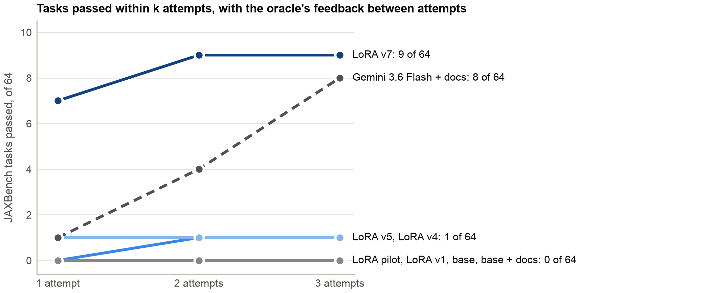

# Teaching a 4B Gemma to write TPU kernels

**Subtitle:** an oracle-verified Pallas dataset from an open-weights teacher, and a 4B model that passes as many JAXBench tasks as
Gemini Flash with docs

<!-- Draft (Nov 12). Every JAXBench number is recomputed by paper/analysis/jaxbench.py from paper/data/. Limit: 3,000 words. -->

## Abstract

Pallas kernels can beat XLA on TPUs by large factors, but writing them is specialist work, and frontier models struggle with the
thinly documented DSL. We ask whether Gemma 4 E4B, a model small enough to run on a laptop, can learn it from verified examples.

We build:
1. **A TPU oracle.** It accepts a solution only if it is a real Pallas kernel, compiles and runs at full size on a TPU v6e, matches a
   float32 answer key on three seeds, and runs at least 0.7x as fast as XLA.
2. **A training set of 2,304 rows.** Every target was judged correct by that oracle, and 85% also meet its speed bar. The kernels
   come from an open-weights teacher (Kimi K3.1), refined over up to three rounds of oracle feedback, plus a template generator for
   kernels at production scale. Every row is screened against JAXBench at the instance level.
3. **An evaluation** on JAXBench's 50 tasks. Every model gets the same three attempts per task.

On JAXBench's 50 tasks, our LoRA adapter passes **9 tasks within three attempts**, against 0 for base Gemma and 7 for Gemini
Flash with 25k tokens of Pallas docs, and **7 on the first attempt**, against Flash's 1. All nine of its kernels run faster than XLA
(1.30-1.39x). Eight are matmul fusions that tile M, N and K to fit TPU memory at production size: the expert part of the job, applied
to operation chains the model was never trained on. The gain comes from targeted data at JAXBench's production scale, and the
kernels assume sizes that their tiles divide.

## 1. Introduction

Pallas is JAX's kernel language for TPUs. A good kernel tiles its arrays to fit VMEM, keeps the MXU busy, and fuses operations XLA
would run separately. But Pallas is young, and its TPU lowering rules (block shapes, layouts, supported primitives) are strict. In
JAXBench, more than half of failed samples are API misuse or compile errors. The JAXBench authors name "fine-tuning or reinforcement
learning from execution feedback on curated Pallas corpora" as future work; to our knowledge no fine-tuned Pallas model, and no
result for a small open model on JAXBench, has been published.

We fine-tune Gemma 4 E4B with LoRA on oracle-verified kernels. Our contributions:
- an oracle whose kernel check rejected 12 of Gemini Flash's 64 first attempts on JAXBench;
- a 2,304-row training set from an open-weights teacher and a template generator, every target TPU-verified, screened against
  JAXBench at the instance level;
- the finding that a 4-bit served LoRA must be trained on, and folded into, the exact quantized weights it will run on;
- a 4B model that writes production-scale tiled matmul kernels faster than XLA, passing as many tasks as Gemini Flash with docs.

## 2. Related work

**Kernel benchmarks.** KernelBench measures LLM-written CUDA kernels; KernelBench-Verified shows that weak tests let models
reward-hack. JAXBench runs 50 TPU workloads; with curated docs, iterative refinement solves 48 using up to 144 attempts per task.
None of these trains a model.

**Training kernel models.** KernelLLM fine-tunes Llama 3.1 8B on PyTorch-Triton pairs; AutoTriton, TritonRL, Dr. Kernel and
Kevin-32B add RL from execution, for GPUs. Several add checks against reward hacking; our kernel check is the TPU analogue.

## 3. Method

### 3.1 Task format

A task is a plain-JAX module, as in JAXBench. `CONFIG` holds all sizes, `create_inputs()` returns seeded arrays, and
`workload(*inputs)` is the reference. A solution defines `workload` with the same arguments and does its main computation inside
`pl.pallas_call`.

### 3.2 The oracle

Each solution goes through four steps; the first failure is the verdict.
1. **Is it a kernel?** Traced without running: there must be a `pallas_call`, the output must depend on it, and outside it only
   layout and dtype primitives or small integer metadata are allowed. Otherwise `not_a_kernel`.
2. **Does it compile and run** on a TPU v6e at the task's full size? Otherwise `compile`, `vmem`, `mosaic`, `timeout` or `runtime`,
   with the chip's error text as feedback.
3. **Is it correct** on 3 seeds against a float32 answer key at matmul precision "highest" (atol = rtol = 1e-2, or at most twice
   XLA's own error)? Otherwise `wrong`.
4. **Is it fast enough?** `speed_vs_xla = t_xla / t_kernel` (medians of 20 timed calls). Correct at 0.7x or faster is `pass`;
   otherwise `correct_slow`.

Every result here uses the same oracle files (sha `c9a07d9298a1`), JAX 0.10.2 and a v6e-1. Step 1 is static, so it runs on CPU with
an identical verdict. Some kernels halt the TPU core and make every later item in the same process fail; our harness re-runs those
victims in a fresh process and never counts them as verdicts.

### 3.3 Problems and contamination control

Problems come from KernelBench Level 1-2 and GPU MODE's KernelBook (both ported to JAX and checked against the PyTorch module),
operators written for this project (attention variants, MoE routing, quantized matmuls, KV-cache updates, SSM scans), and
references for public Pallas kernels. Every problem first passes seven CPU checks at full size (loads, fits HBM, deterministic and
seed-varying inputs, finite outputs).

**The exam** is all 73 JAXBench files (50 level 1 references, 23 level 2 kernels). A training problem is excluded if it is the same
kernel as an exam instance:
- **Copies:** KernelBench stems that JAXBench ported, and near-duplicate text on two token streams (identifiers kept, and identifiers
  abstracted).
- **Same op chain:** we trace `workload` to a jaxpr and canonicalize the primitive chain. A problem is out if its chain equals a
  k-task's once add, subtract, multiply, divide, negate and layout ops are set aside, and log-softmax is read as softmax. Unsure
  means out.
- **Adversarial review:** a review of 273 problems that an earlier, family-level rule had excluded re-admitted 191 and kept out 43
  instance copies and 39 unsure cases.

Applied to the final data, the same-chain test removed:

| Source | Removed |
|---|---|
| Base problems | 58 |
| Scaled or teacher-added problems | 27 |
| Generated rows | 36 |
| Layout items | 20 |
| Softmax-template items | 2 |

The 29 dev items share no normalized op chain with any training row. Three independently written checkers verify the final file: no
dropped problem, dev task or dev chain is present, no generated row has an exam chain, no JAXBench task name appears, and every
generated target matches a TPU-passed item. The training reference closest to any JAXBench reference has a line similarity of 0.31.

### 3.4 Training data

Only kernels that passed the oracle (`pass`, or `correct_slow` in the base set) become targets, and teacher reasoning is never
trained on. Rows are built by the evaluation's own prompt function, so they are byte-identical to what the model sees at test time.
A repair row is the problem, the failed kernel(s), the oracle's verbatim feedback and the passing kernel. Loss is on the final turn
only, so failed kernels are context, never targets.

**Teacher.** Kimi K3.1 (open weights) wrote kernels for 1,672 KernelBench, KernelBook and authored problems with a fixed prompt
(kernel rules plus about 25k tokens of Pallas docs). On the first attempt 1,345 passed step 1 on CPU; of the attempts judged on the
TPU, 434 passed and 267 were correct but slow. A repair round prompted with the earlier kernels and the oracle's feedback added 235
passing problems; a third round, on 486 problems Kimi had failed twice, added 103.

**Exam-scale rows.** Matmul kernels must tile to fit VMEM at production sizes, but our teacher's matmul problems were small: a median
weight of 2 MB, against 268 MB in JAXBench's matmul tasks (K = 8,192). A kernel that loads its weight whole passes at the first size
and fails at the second. We added rows at JAXBench's scale in three ways:
- **Scaling.** We scaled 198 matmul-dominant problems so that max(K, N) is between 4,096 and 16,384 and the weight is at least
  64 MB, then re-ran their existing kernels. 50 still passed (45 after contamination drops).
- **Fixing.** Kimi fixed the rest with the oracle's feedback and a TPU-measured tiling policy in the system prompt:
  - set `vmem_limit_bytes` to 124 MiB;
  - tile (tm, tn, tk) as (2048, 2048, 1024);
  - for row reductions, keep N whole with tm = 1024 and tk = 512 (256 at N = 8,192).

  After contamination drops, 48 problems with a passing first-round fix and 38 with a passing second-round fix remain. Each becomes a
  repair row and a turn-0 row.
- **Template generator.** A generator emits matmul-epilogue, batched-matmul and row-reduction kernels from one policy template.
  Each is checked numerically at a shrunken size, then judged at full size on the TPU:
  - 269 of 281 passed;
  - a layout variant (transposed weights, bias before a reduction, scale and shift) gave 104 of 111;
  - a whole-row output template for f32 softmax-type reductions at N = 8,192 gave 61 of 61.

  Almost every generated row (354 of 355) also appears once more in a **surface variant**: renamed arguments, CONFIG keys and
  docstring, so the policy is tied to the operation rather than the generator's wording. A variant is admitted only with two proofs:
  its target's AST equals the judged kernel's after renaming, and its reference is bit-identical at a shrunken size. A stratified
  sample of 91 variants then passed the TPU oracle 91 of 91.

**Composition.**

| Part | Rows |
|---|---|
| Kimi base set (after contamination and slow-matmul drops) | 1,172 |
| Exam-scale Kimi kernels (unchanged, fix rounds 1-2) | 217 |
| Third-round Kimi kernels (repair + turn-0 rows) | 206 |
| Template rows (originals + surface variants) | 709 |
| **Total** | **2,304** |

Teachers: Kimi 1,595 rows, generator 709 (30.8%). Kinds:
- 1,512 single-turn rows;
- 584 repair chains, 444 of them ending in a pass;
- 348 targets correct but below 0.7x (15%). All are non-matmul teacher rows: below-bar matmul rows were dropped, since they teach
  the untiled designs the exam-scale rows correct.

The longest row is 11,854 tokens and the longest answer 5,819 (the eval cap is 8,192).

### 3.5 Training and serving

LoRA rank 64, alpha 128, on the attention and MLP projections of Gemma 4 E4B:
- 2 epochs, learning rate 1e-4, gradient accumulation 4, loss on the final assistant turn;
- 1,152 optimizer steps (AdamW, cosine schedule) in 89 minutes on one A100-80GB;
- mean training loss 0.157 in epoch 1 and 0.075 in epoch 2.

We score the final adapter; the epoch was fixed before training.

**The fold matters.** We serve with Ollama, which does not load LoRA adapters, so the adapter is folded into the official 4-bit QAT
GGUF that the baselines use. A LoRA trained on bf16 weights and rounded back into Q4_0 is mostly erased: its weight changes are
mostly far below one Q4_0 rounding step. We therefore:
- **train against the exact dequantized weights Ollama serves**;
- **store the 258 LoRA-touched tensors at Q8_0** as `dequant(Q4_0) + delta`, with every other tensor byte-identical.

The trainer's and Ollama's prompt token counts agree on all 64 turn-0 prompts.

### 3.6 Evaluation

**Tasks.** JAXBench's 50 tasks: 33 k-tasks and 17 p-tasks. We also wrote plain-JAX references for JAXBench's 14 level 2-only
kernels; no model passes, or is correct on, any of the 8 whose reference matched Google's kernel on the TPU, so every count below is
the same with them included.

**Budget.** Every arm gets a first attempt and two repairs with the oracle's feedback, 3 attempts per task (against up to 144 in the
JAXBench paper).

**Arms.**
- Base Gemma 4 E4B with the reference only (`bare`), and with 25k tokens of Pallas docs (`docs`).
- Our adapter.

  All three Gemma arms decode greedily on Modal A10Gs with Ollama 0.40.14: one chain, thinking off, 8,192 output tokens.
- Gemini Flash with docs (served as `gemini-3.6-flash`), at its default temperature, with thinking on (median 5,518 thinking tokens
  per attempt) and up to 65,536 output tokens.

**Metrics.**
- `pass_within_3`: a pass on any attempt.
- `correct_within_3`.
- `pass@1`.
- Parity: correct at 0.97x or faster.

Paired comparisons use an exact two-sided McNemar test on per-task outcomes.

No JAXBench task, reference or kernel is used for training. This adapter is the last of several we evaluated on JAXBench during
development.

## 4. Results

### 4.1 JAXBench

| Arm | Pass within 3 | Correct within 3 | pass@1 | Parity | k-33 | p-17 |
|---|---|---|---|---|---|---|
| Gemma 4 E4B, bare | 0/50 | 0 | 0 | 0 | 0 | 0 |
| Gemma 4 E4B + docs | 0/50 | 0 | 0 | 0 | 0 | 0 |
| Gemini Flash + docs | 7/50 | 36 | 1 | 4 | 5 | 2 |
| **Gemma 4 E4B + our LoRA** | **9/50** | **9** | **7** | **9** | **8** | **1** |

Our adapter passes:
- 12p (RMSNorm) and 19k, 20k, 27k, 37k, 41k, 44k on the first attempt;
- 35k and 47k after one repair.

Every pass runs at 1.30-1.39x XLA, and every correct kernel it writes is a pass. Four passes (19k, 20k, 37k, 41k) meet the oracle's
second correctness rule (error at most twice XLA's own) rather than the fixed tolerance; their error equals XLA's.

| Ours vs | Ours only | Other only | p |
|---|---|---|---|
| Base Gemma, bare or docs (pass within 3) | 9 | 0 | 0.004 |
| Gemini Flash + docs (pass within 3) | 8 | 6 | 0.79 |
| Gemini Flash + docs (pass@1) | 6 | 0 | 0.031 |

With a Holm correction across the three comparisons, the advantage over base Gemma remains significant (p = 0.012), and the
first-attempt advantage over Flash is p = 0.06. Our adapter and Flash solve almost disjoint sets: only 12p is common. Flash is far
more often *correct* (36 tasks), but its kernels are slow: its best correct kernel per task has a median of 0.54x XLA (0.31x on
first attempts), against 1.37x for ours. Flash's control is incomplete on two tasks only our adapter passes: on 35k its first attempt crashed a TPU core (re-judged,
it is correct but slow at 0.22x) and its repairs were never generated; on 19k it received two attempts, not three.

### 4.2 Where it fails

**VMEM.** 8 first attempts fail on VMEM. On repair, 2 become passes and 6 fit in VMEM but compute the wrong values. All 6 are matmuls
followed by a row reduction (logsumexp, softmax, sigmoid-sum, row max), whose epilogue must see a whole row while K is tiled.

**Compile errors are not repaired.** 41 of 64 first attempts fail to compile. In 80 of the 81 cases where a compile failure was
followed by another attempt, the next attempt also failed to compile. The oracle's feedback fixes memory layout, not API misuse.

**Convolutions.** None of the 24 attempts on the 8 conv-led k-tasks passes step 1.

**p-tasks.** Only RMSNorm passes. The other p-tasks are production kernels (paged and ragged attention, MoE, SSMs), and the
exam-scale data is matmul-centric.

## 5. Discussion and limitations

- **Benchmark-informed data.**
  - The exam-scale rows were sized to JAXBench's matmul scale, and 16 generated rows have exactly the input shapes of the matmul
    tasks we pass.
  - Those tasks are one elementwise op from the nearest generated kernel (two for 47k, four for 27k), and the layout rows follow
    the layouts JAXBench uses.

  No exam task, reference or kernel is in training: the model applies a production tiling design to operation chains it has not
  seen.
- **Partial tiles.** Every template row has power-of-two sizes, so its tiles always divide the arrays, and the adapter's kernels
  assume they do. At two unseen shapes where they do not, (2048, 7168, 9216) and (3072, 7680, 8704), the eight passed matmul tasks
  pass 3 of 16 times: the remainder is never computed, or the chosen block is one the TPU rejects. Training rows whose sizes leave
  partial tiles are the natural next step.
- **Testing is not verification.** Reading the targets after training, we found 5 rows (0.2%) whose kernels pass the oracle through
  input-dependent shortcuts:
  - a mean in place of a median, at 3,266x XLA;
  - polynomial approximations accurate only on the reference's input range.

  Three seeds from fixed input distributions cannot rule these out. The adapter trained on them; the published dataset excludes them.
- **Template share.** 30.8% of rows come from one generator template; over two epochs each template kernel (with its variant) is
  seen 4 times, most teacher kernels twice. The dev set is template items, so its loss (0.0002) measures template recall rather than
  tiling ability.
- **Slow targets.** 15% of targets are correct but below the bar, and most Kimi kernels set no VMEM limit while the exam-scale and
  generated rows set 124 MiB. The model sees mixed signals outside matmuls.
- **Decoding and budget.** Gemma decodes greedily with one chain; Flash samples at its defaults because it loops at temperature 0.
  Three attempts is far below JAXBench's 144, and one greedy chain gives no confidence interval per task.
- **Timing.** Host-clock timing pulls very small kernels toward 1.0x on both sides of the ratio.

## 6. Conclusion

Verified, targeted data taught a 4B model the expert core of TPU matmul kernels, for sizes its tiles divide: tiling M, N and K,
accumulating in f32 VMEM and fusing the epilogue. Base Gemma passes none of JAXBench's 50 tasks; with 2,304 verified rows and
two epochs of LoRA it passes 9, as many as Gemini Flash with docs, every one faster than XLA, and 7 of them on the first attempt.
What remains is partial tiles, API correctness (most failures never compile) and kernels outside the matmul family.

## Reproducibility

Repository `Art4v/gemma-hackathon-research`:
- **Oracle:** `oracle/` (sha `c9a07d9298a1`).
- **Data:** GitHub release `dataset-final`:
  - `train.jsonl` (2,299 rows; the 5 shortcut rows removed);
  - `train_as_trained.jsonl` (2,304 rows, exactly what the adapter trained on);
  - `val.jsonl`, a datasheet and checksums.
- **Evaluation:** `control/bench.py`, and `control/scoring/` for the fold and the JAXBench runner.
- **Results:**
  - `paper/data/runs/`: the raw rows of every arm;
  - `paper/analysis/jaxbench.py`: recomputes every table here;
  - `paper/notebook/`: the companion notebook, which recomputes them from GitHub.
