# Paper figures

Fifteen figures for the writeup, each as a vector PDF and a 300 dpi PNG. Five are pipeline diagrams, five describe the
training data, one shows the training loss, and four show the JAXBench results. Captions below are drafts for the
writeup; every number in them is computed by `src/extract.py` from files at fixed commits.

They replace the three v1-era figures that were here: success vs attempts is now `fig11`, the speed distribution is
`fig08`, and outcome by task type is `fig14`.

## Regenerate

```
python3 -I paper/figures/src/extract.py            # reads the commits below with git show, writes src/data.json
cd paper/figures/src
uv run --with matplotlib python diagrams.py        # fig01 to fig05
uv run --with matplotlib python charts.py          # fig06 to fig15
```

`extract.py` reads fixed commits, all kept by `archive/*` tags (`git fetch origin --tags`):
- `2efa6a5`, the training file (tag `archive/hruday/kimi-k31`);
- `487973d`, the scored run and the 64 references (tag `archive/hruday/v4-runs`);
- the TPU verdicts of the training candidates (tag `archive/oracle-results/karthik-gen7`);
- `eadf22b`, the loss log (tag `archive/aarav/paper-v7`);
- `da04f91`, the frozen rows of the four arms (tag `archive/hruday/paper-v7`).

It asserts
each arm against `paper/analysis/results.json` (for example 9 of 58 for the adapter) and stops if a source has drifted.

## Pipeline diagrams

| Figure | Draft caption |
|---|---|
| 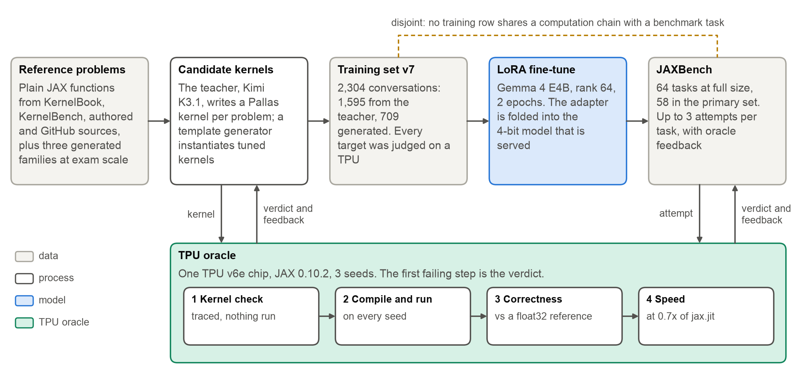 | **fig01_overview.** The study in one picture: two sources of training targets, both judged on a TPU; a LoRA adapter on Gemma 4 E4B; the same oracle scores the fine-tuned model on JAXBench. |
| 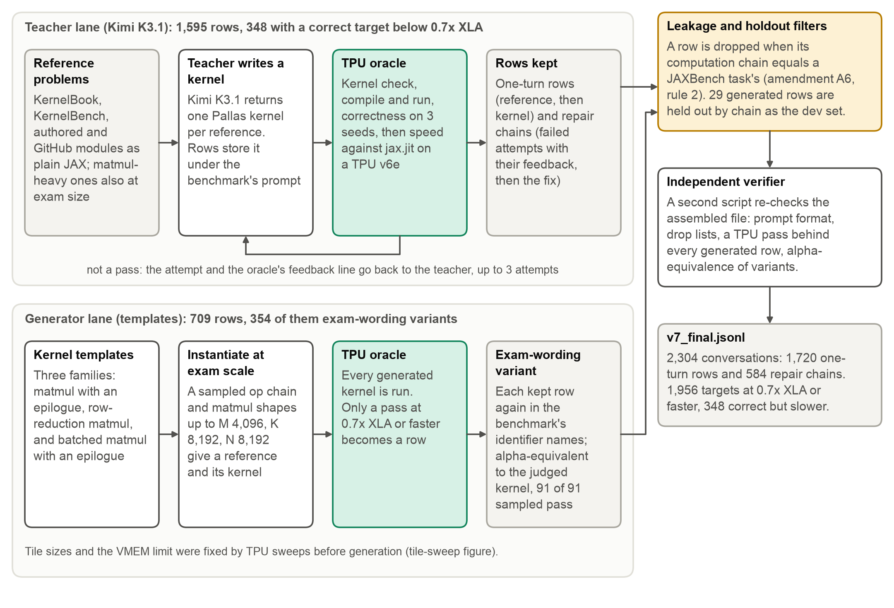 | **fig02_dataset_pipeline.** How the 2,304 training conversations were built. The teacher lane (Kimi K3.1, 1,595 rows) gets up to 3 attempts per problem with the oracle's feedback. The generator lane (709 rows) instantiates three kernel templates at exam scale and keeps only TPU passes. Both lanes go through the leakage filter (amendment A6, rule 2) and a second, separately written verifier. |
| 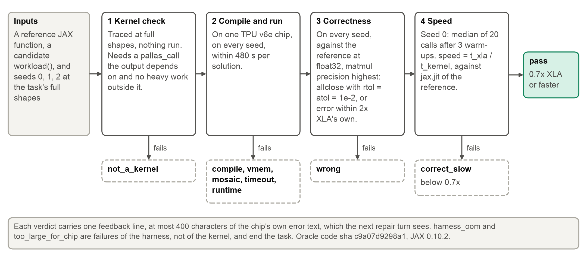 | **fig03_tpu_oracle.** The oracle's steps and the verdict each failure produces. A pass needs a real Pallas kernel, a compile and run on a TPU v6e, a correct output on 3 seeds, and at least 0.7x the speed of `jax.jit` on the reference. |
| 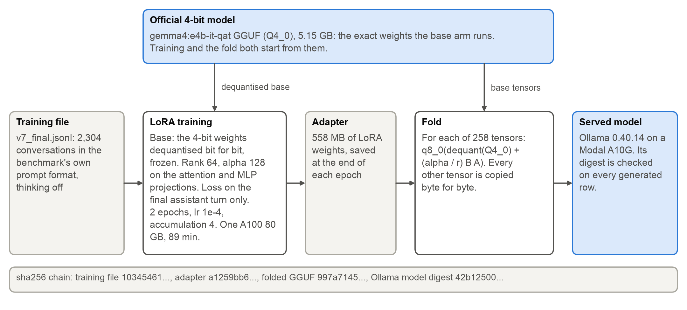 | **fig04_training_serving.** Training and serving start from the same 4-bit weights. The adapter is trained on the dequantised Q4_0 base, then folded into it and served through Ollama. The sha256 chain ties the scored model to the training file. |
| 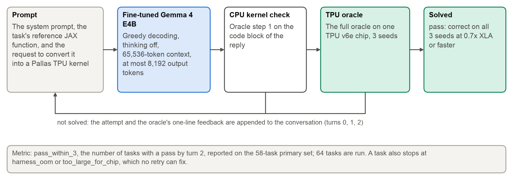 | **fig05_evaluation_protocol.** The evaluation loop: up to 3 attempts per task, with the failed attempt and the oracle's one-line feedback appended between attempts. |

## Training data

| Figure | Draft caption |
|---|---|
| 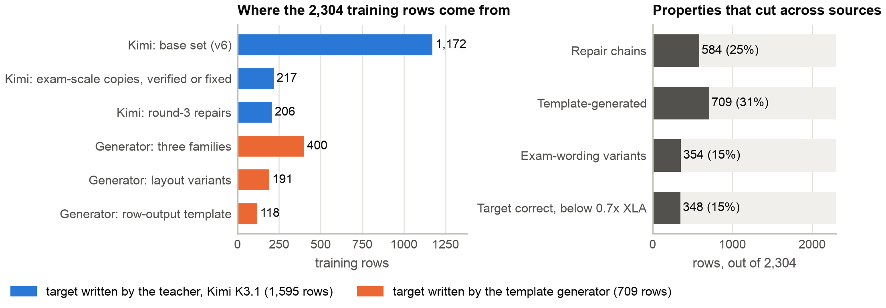 | **fig06_dataset_composition.** Left: training rows by source set. Right: properties that cut across sources. 709 rows (31%) come from templates, 584 (25%) are repair chains, and 348 teacher targets (15%) are correct but slower than 0.7x XLA. |
| 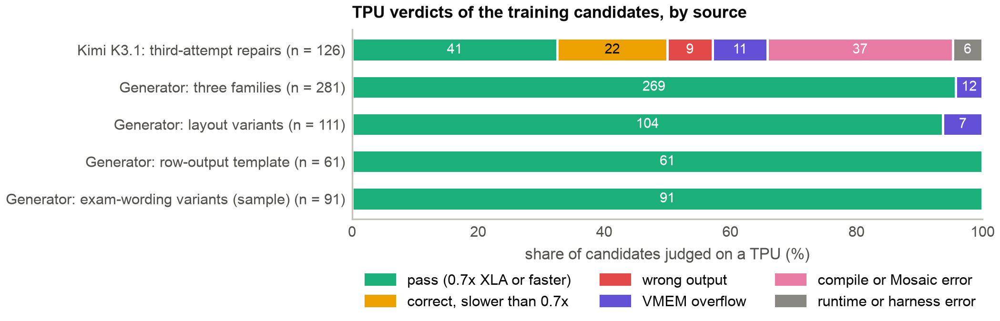 | **fig07_candidate_verdicts.** TPU verdicts of training candidates, by source. The teacher bar covers only the 126 third-attempt candidates judged on Karthik's TPU project, a subset of that round's 486 problems, all on problems the teacher had already failed twice; it is not a first-attempt yield. Generated kernels fail only on VMEM (19 of 392 in the first two generator rows). The last bar is a 91-row sample of the 354 exam-wording variants. |
| 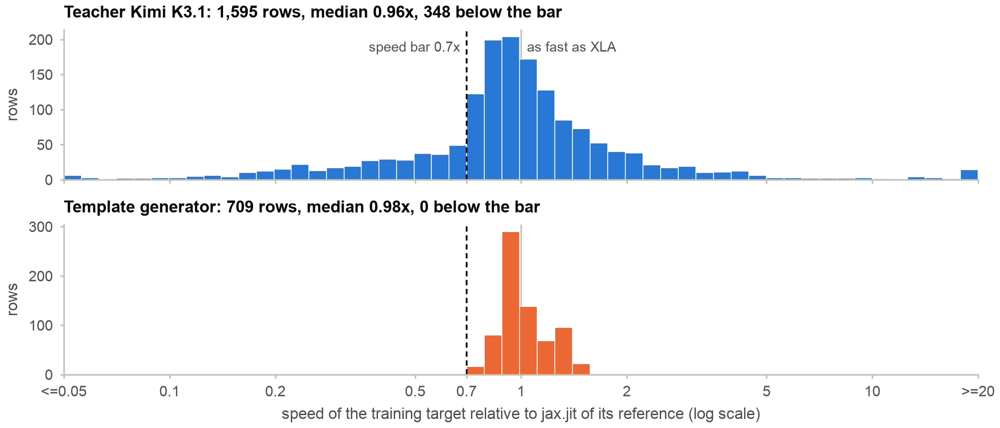 | **fig08_target_speed.** Speed of each training target against `jax.jit` of its reference. Teacher targets have a median of 0.96x and a long tail on both sides; generated targets sit between 0.76x and 1.51x. The 17 teacher values outside 0.05x to 20x are drawn in the end bins. |
| 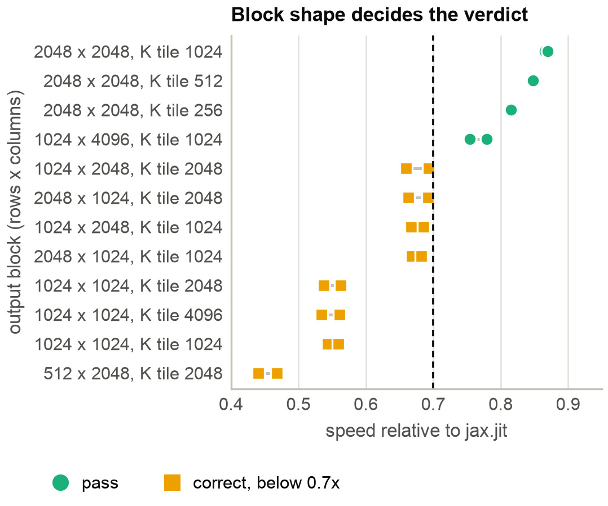 | **fig09_tile_sweep.** The TPU sweep that fixed the generator's tiling for a matmul with M = 2,048. Only output blocks of 2,048 x 2,048 or 1,024 x 4,096 clear the 0.7x bar; the same kernel with smaller blocks is correct but too slow. Each point is one kernel run. |
| 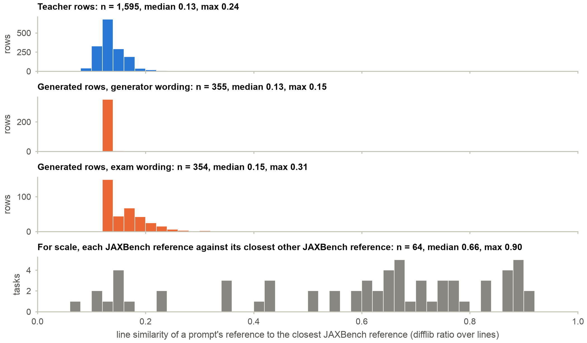 | **fig10_prompt_similarity.** Text similarity of each training prompt's reference to its closest JAXBench reference (difflib ratio over stripped, non-blank lines). The highest value for any training row is 0.31. For scale, the bottom panel shows each JAXBench reference against its closest other JAXBench reference (median 0.66). |

## Training

| Figure | Draft caption |
|---|---|
| 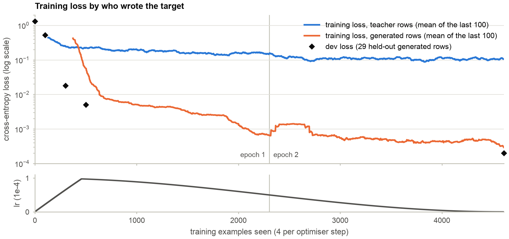 | **fig15_training_loss.** Training loss over the 4,608 example steps, split by who wrote the target, with the learning rate below. Loss on generated rows falls about two orders of magnitude below loss on teacher rows (epoch 2 means 0.0006 and 0.108). The dev set holds only generated rows, so its loss follows the generated curve and is not evidence of generalisation. |

## Results

| Figure | Draft caption |
|---|---|
| 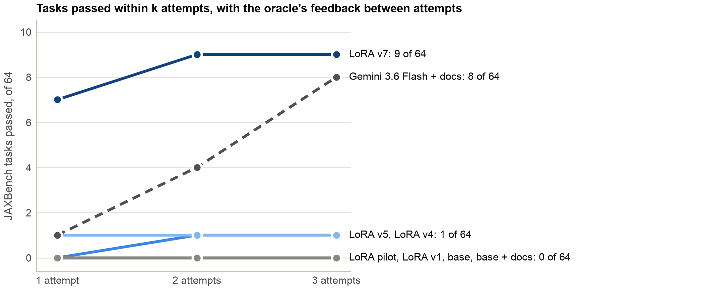 | **fig11_success_vs_attempts.** JAXBench tasks passed within 1, 2 and 3 attempts, all 64 tasks. Gemma 4 E4B with our LoRA passes 7 on the first attempt and 9 within 3; the base model passes none with or without documentation. Gemini 3.6 Flash with documentation is drawn dashed because it is a different, larger model, run with thinking on; it passes 1, 4 and 8. |
| 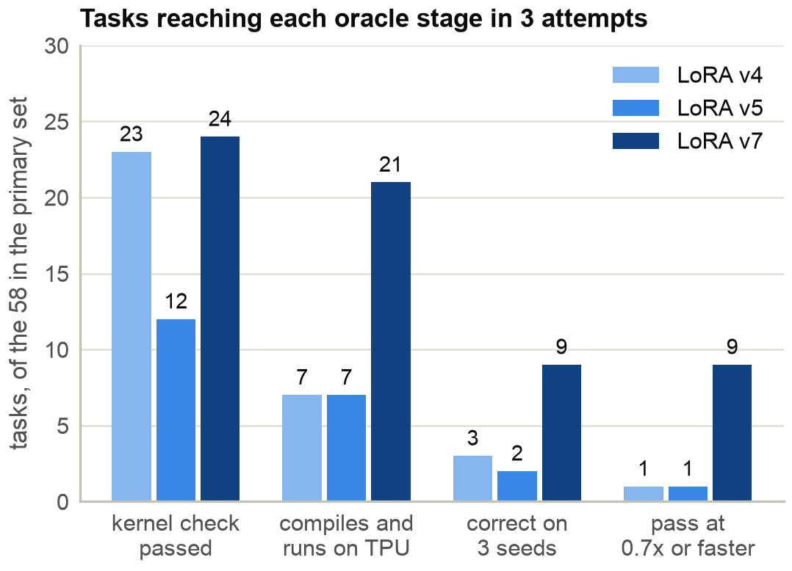 | **fig12_results_funnel.** Tasks of the 58-task primary set that reach each oracle stage within 3 attempts. The adapter gets 24 tasks past the kernel check, 21 to compile and run, and 9 to a correct output, all 9 of which pass. Flash gets 36 tasks to a correct output but only 7 to the 0.7x bar. |
| 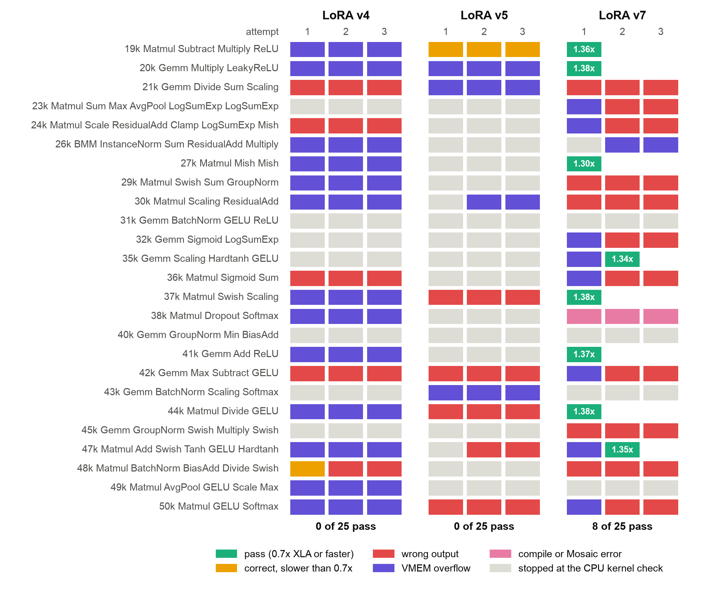 | **fig13_results_by_task.** Every attempt on the 25 matmul-led k-tasks. The adapter passes 8 at 1.30x to 1.38x XLA, 6 of them on the first attempt; of its 8 first-attempt VMEM failures, 2 are repaired to a pass and 6 become wrong outputs. Flash is correct but slow on most first attempts and passes 4. Flash's grey cell on 35k is a halted TPU core; re-judged alone, that kernel is correct at 0.22x, and its two repair attempts were never made. On 19k Flash got 2 attempts. |
| 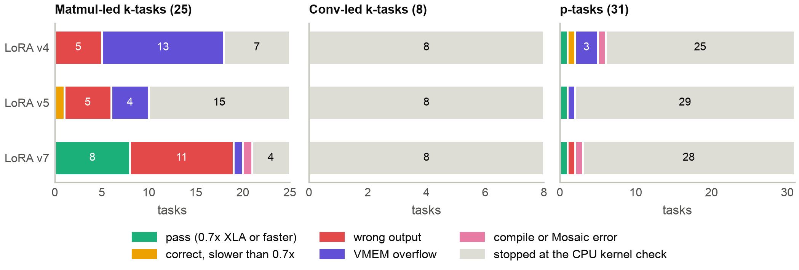 | **fig14_outcome_by_task_type.** Final outcome per task by task type (the first pass, else the last attempt). The adapter's passes are 8 matmul-led k-tasks and 1 p-task. None of its attempts on the 8 conv-led k-tasks gets past the CPU kernel check, and 28 of 31 p-tasks stop there too. Flash passes 4, 1 and 3. |

## What a reader should know

- The task counts are small: 64 tasks, one greedy sample per attempt. The paper's tests are in
  `paper/analysis/results.json`; these figures assert its counts and do not recompute the tests.
- 8 of the adapter's 9 passes are on matmul-led k-tasks, the family the generator's templates target. fig10 shows the
  prompts are not near-copies of JAXBench references as text, but it measures surface similarity only. Equality of
  the computation chain is handled by the A6 filter, not by this figure.
- fig11 to fig14 compute all four arms from `paper/data/runs/` on `hruday/paper-v7` @ `da04f91`. `extract.py` asserts
  that the adapter's rows there are byte-identical to the scored run at `487973d` and that every arm agrees with
  `paper/analysis/results.json`.
- Flash's first attempt on 35k is recorded as `harness_oom` (a halted core). The re-judge, `correct_slow` at 0.22x, is
  in `oracle/results/flash-35k-rejudge/` on `oracle-results/karthik-gen7`; the figures show the frozen row.
- The Flash arm differs from the Gemma arms in more than size: default sampling, thinking on (median 5,518 thinking
  tokens), up to 65,536 output tokens. On 19k it got two attempts, not three: an oracle crash ended the task.
- The only typed-in values are the five dev-loss points in fig15, from `paper/parts/training_v7.md` (`aarav/paper-v7` @ `eadf22b`); the
  training-loss curves are computed from `loss_v7.csv` on the same commit.
- 263 of the 354 exam-wording variants were not run on a TPU. They are alpha-equivalent to a judged kernel, and the
  91 sampled all pass (fig07).
- Aarav's agent found 5 teacher targets that pass the oracle through input-dependent shortcuts (issue #5,
  2026-11-12). They are in the training file and so in fig06 and fig08; one of them is the 3,266x outlier.
- The fold re-quantises the 258 adapted tensors to q8_0 (fig04), so the served weights differ from the trained ones
  by that rounding.

Not drawn: a kernel listing, which is better typeset in the paper itself.
